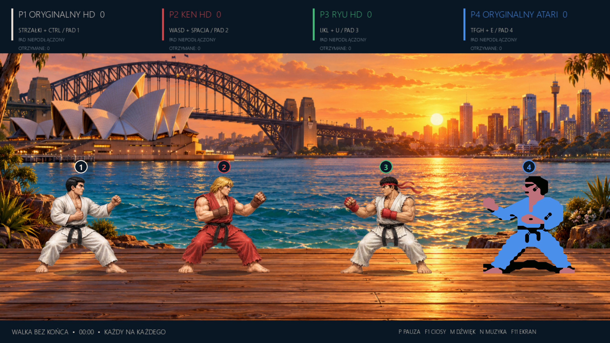

# International Karate — Recrafted 6.1 HD

Gra dla czterech osób na jednym ekranie. Klawiatura i opcjonalne pady,
postacie oryginalne HD, Ryu, Ken oraz klasyczny wygląd Atari.
Animowane fale, chmury i poświata słońca na planszy w Sydney.

[Pobierz wersję dla Windows](https://github.com/grzegorzmusial/international-karate-recrafted/releases/tag/v6.1)
i rozpakuj ZIP.



Uruchomienie ze źródeł wymaga Pythona 3.14.

```powershell
python -m pip install -r requirements.txt
python game.py
```


Uruchom `InternationalKarate-v6.1.exe`. Gra startuje w pełnym ekranie.
Nowe postacie są rysowane na warstwie 2560×1440, z osobnych szczegółowych
arkuszy HD. Cztery osoby walczą jednocześnie, bez końca, bez komputerowych
rywali i bez przerywników z deskami.

## Wybór wyglądu

Każdy gracz wybiera niezależnie jedną z czterech opcji:

- **ORYGINALNY HD** — odświeżony zawodnik International Karate, tradycyjne
  kimono z długimi rękawami, w kolorze gracza.
- **RYU HD** — czarne włosy, czerwona opaska i rękawice, białe kimono bez rękawów.
- **KEN HD** — blond włosy, czerwone kimono i brązowe rękawice.
- **ORYGINALNY ATARI** — dotychczasowe, pikselowe postacie.

W menu zmieniaj postać kierunkami lewo/prawo na swoim padzie albo klawiaturze:

| Gracz | Zmiana postaci w menu | Sterowanie podczas walki | Alternatywnie |
|---|---|---|---|
| 1 | ← / → | strzałki + Ctrl | pad 1 |
| 2 | A / D | WASD + spacja | pad 2 |
| 3 | J / L | IJKL + U | pad 3 |
| 4 | F / H | TFGH + E | pad 4 |

Można również klikać lewą lub prawą część wiersza gracza.
**F2 w menu** przełącza cały zestaw między oryginalnymi postaciami HD
a Ryu / Ken / Ryu / Ken. Enter lub Fire na padzie rozpoczyna walkę.
Wybór zapisuje się w `settings.json` obok EXE i wraca przy kolejnym uruchomieniu.
Kolorowe numery nad postaciami odróżniają graczy także przy takim samym wyglądzie.

## Ruchy i pady

Zmiana wyglądu nie zmienia sterowania, czasu ruchów ani masek trafienia.
To nadal ruchy International Karate, z nowym wyglądem, a nie zestaw specjalnych
ciosów Street Fightera. Zachowane są obroty, podcięcia, upadki, wstawanie
i przechodzenie przez innych zawodników.

Fire + góra powtarza skoki z kopnięciem. Fire + góra po skosie powtarza
salta w przód lub w tył. Puszczenie klawiszy kończy serię po bieżącym ruchu.
Pozostałe ciosy wymagają zwolnienia kombinacji przed następnym wykonaniem.
Fire + dół i Fire + dół po skosie do tyłu pozostawiają zawodnika obróconego.

Na padzie: lewa gałka lub krzyżak = kierunek; A / × oraz pozostałe główne
przyciski po prawej = Fire. Start / Options rozpoczyna grę i włącza pauzę.
Klawiatura działa równolegle. Pady można podłączać podczas gry; odłączenie
jednego nie zmienia przypisania pozostałych i włącza pauzę.

- F1: mapa ruchów.
- P / Enter / Start: pauza i powrót.
- Esc: pauza; ponownie Esc: menu. W menu Esc zamyka grę.
- F11: pełny ekran / okno. Argument `--windowed` uruchamia w oknie.
- M: wszystkie dźwięki; N: muzyka.

Dźwięk wybiera głośniki SMSL, jeśli są dostępne, w przeciwnym razie urządzenie
domyślne. Muzyka i efekty pozostają nagraniami oryginalnego PCM POKEY.
Program jest samodzielny: podczas uruchamiania nie potrzebuje ATR ani emulatora.

## Grafiki i animacja

Na planszy w Sydney poruszają się fale i odbicie zachodu, po niebie płyną
chmury, a poświata słońca zmienia jasność. Efekty działają automatycznie.

Wbudowane **imagegen** przygotowało 12 przezroczystych arkuszy postaci:
`assets/hd/original-1.png` do `original-4.png`,
`assets/hd/ryu-1.png` do `ryu-4.png` i `assets/hd/ken-1.png` do `ken-4.png`.
Łącznie pokrywają 44 oryginalne obrazy pozy: stanie, chód, wszystkie ciosy,
skoki, obie rotacje salta i kolejne fazy upadku. Identyczne oryginalne pozy
korzystają z tego samego rysunku HD, żeby nie przeskakiwały po lądowaniu.

Pełne prompty: [analysis/generation-prompts.json](analysis/generation-prompts.json).
Oryginalne plansze referencyjne póz: `analysis/references/`.
Skalowanie i wybór ilustracji są oddzielone od obliczania trafień. Wstawanie
nadal korzysta z póz upadku odtworzonych od tyłu na potrzeby ciągłej walki.

Podglądy: `preview-original-HD.png`, `preview-Ryu-Ken-HD.png`,
`preview-actions-HD.png`, `preview-selection.png`.

## Sprawdzenie i źródła

**77 testów przeszło**: 45 testów walki, 18 padów, 13 wyglądu/animacji HD
oraz test animacji tła i stabilności pomostu.
Sprawdzono wszystkie 44 obrazy dla trzech zestawów HD, oba odbicia, brak
zmiany masek i stanu walki, ciągłość lądowania, pamięć wyboru, niezależne
sterowanie menu klawiaturami i padami oraz ograniczenie pamięci podręcznej.
Pady sprawdzano na wirtualnych urządzeniach SDL; fizycznego pada nie było
podłączonego podczas tych testów.

Wyniki są w `analysis/test-game.txt`, `test-gamepads.txt` i `test-characters.txt`.
Źródła: `game.py`, `gamepads.py`, `characters.py`, `arena_background.py` i pliki `test_*.py`.
Zależności źródeł: `pygame-ce==2.5.8`, `numpy==2.5.4`.
Sprawdzenie: `python -m unittest discover`.
Wirtualne testy padów wymagają Windows i odłączenia fizycznych padów na czas testu.
